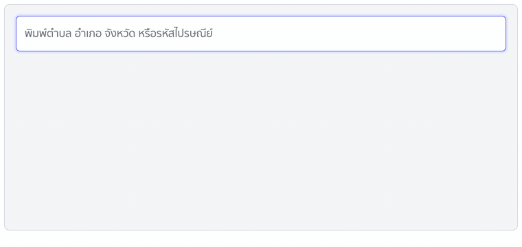

# thaizip

[](https://www.npmjs.com/package/thaizip)
[](https://github.com/naay99999/thai-zip/blob/main/LICENSE)

Fast fuzzy autocomplete for Thai addresses — subdistrict, district, province, postal code.

📚 **[Documentation](https://naay99999.github.io/thai-zip/)** (ไทย / [English](https://naay99999.github.io/thai-zip/en/)) · [Playground](https://naay99999.github.io/thai-zip/en/playground/)



## Features

- **Fuzzy search** in Thai or English — typos and common spellings like `ladprao` still match
- **Postal code lookup** — exact or prefix (`10230`, `102`)
- **Cascade dropdowns** — province → district → subdistrict
- **Bundled data** — 77 provinces, 918 districts, 7,385 subdistricts, loaded lazily
- **Zero runtime dependencies**, works anywhere JS runs; optional React hook

## Install

```bash
npm install thaizip
```

## Quick start

```ts
import { loadDefaultIndex } from 'thaizip/data'
import { searchThaiAddress, resolveThaiAddress } from 'thaizip'

const index = await loadDefaultIndex()

const [record] = searchThaiAddress(index, 'ลาดพร้าว')
resolveThaiAddress(record)
// { subdistrict: 'ลาดพร้าว', district: 'เขตลาดพร้าว', province: 'กรุงเทพมหานคร', postalCode: '10230', ... }
```

React:

```tsx
import { useThaiAddressAutocomplete } from 'thaizip/react'

const { query, setQuery, suggestions, selectSuggestion } = useThaiAddressAutocomplete({ index })
```

Need a ready-made UI component? [`react-thaizip`](https://github.com/naay99999/react-thai-zip) scaffolds one into your project.

## Learn more

- [Getting started](https://naay99999.github.io/thai-zip/en/getting-started/)
- [Guides](https://naay99999.github.io/thai-zip/en/guides/search/) — search, postal codes, cascades, English input, React, custom data
- [API reference](https://naay99999.github.io/thai-zip/en/reference/search/)

## License

MIT
